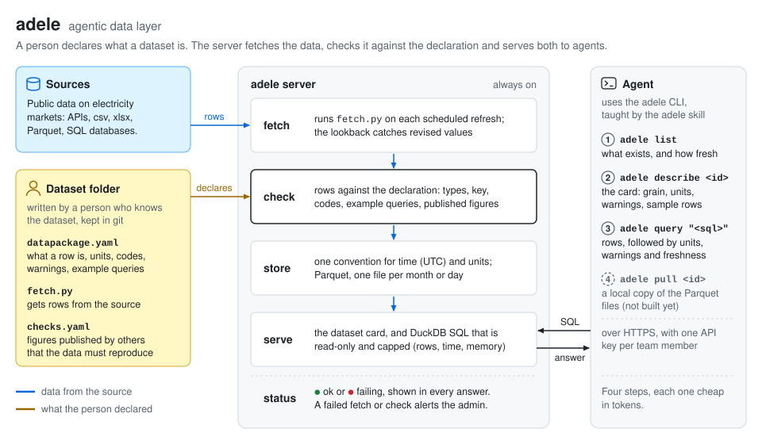
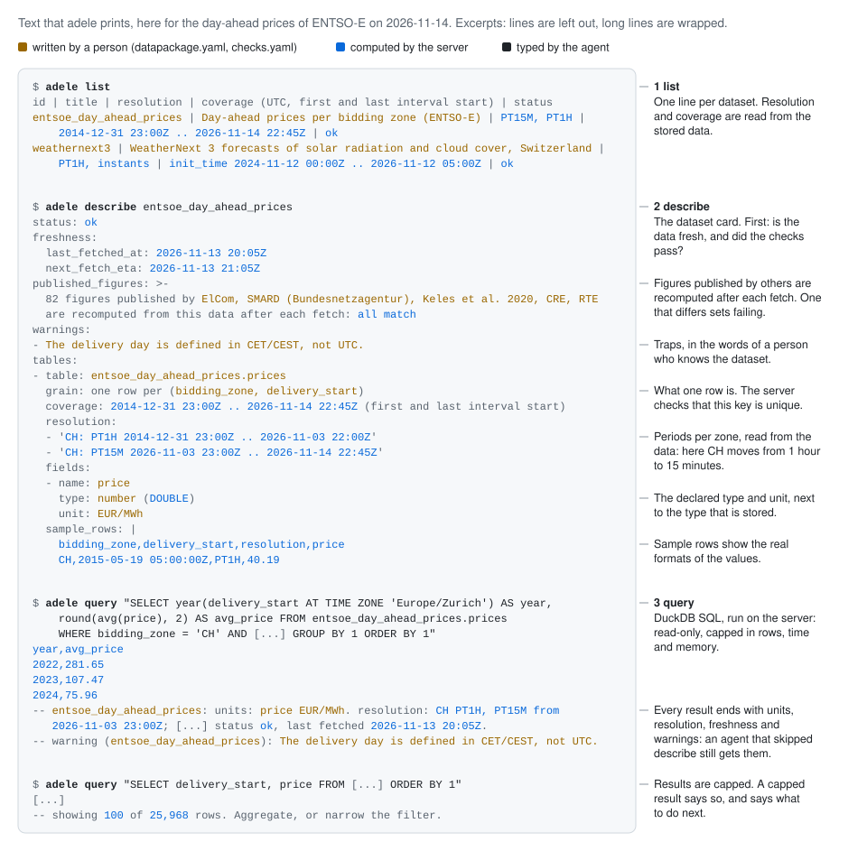

# adele: **a**gentic **d**ata **l**ayer

With adele, **agents know without ambiguity what a dataset is about**, its fields & data type, the timeframe of the dataset (since when, till when, ETA for next refresh). 

## Rationale

Agents write most of the code, and also write most of the queries. They are good at SQL. What they still lack is what the data means.

The meaning is rarely in the rows. From a table of day-ahead prices, an agent cannot tell that the delivery day is defined in CET/CEST and not in UTC. An agent that was not told still returns a number, and nothing shows that the number is wrong.

In adele, a dataset is curated by a domain expert. They write down all its tricks and traps so that an agent can use the data unambiguously.

## Principles

- Quality over quantity: manually curated datasets that agents can "trust".
- Docs as files, data through SQL: agents get yaml descriptions of datasets, then query them with SQL.
- Nothing happens silently: no silent schema change, no silent truncation, no stale data served as fresh.
- Declared means checked: whatever a descriptor states (grain, types, codes, examples), it has been written by a human expert and the server verifies against the data.
- One convention for all datasets: time, units and codes are normalized at ingestion, so an agent learns the rules once.
- Boring standards: Parquet, DuckDB SQL, Frictionless: formats that agents already know, nothing invented.

## From a source to an answer

The reference is [SPEC.md](SPEC.md), and the reasons are in [DECISIONS.md](DECISIONS.md).

### What an agent reads

## Current Usecase

- a dozen different publicly available datasets on electricity markets
- some updated daily, some every 15m.
- most datasets that get downloaded consist of files: parquet, SQL databases, csv, xlsx, etc; some are exposed through an api
- almost all datasets are tabular (or at least relational)
