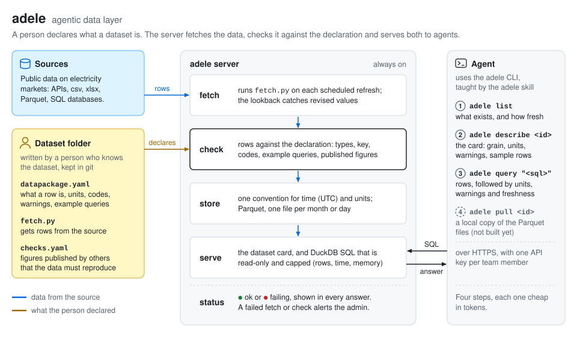
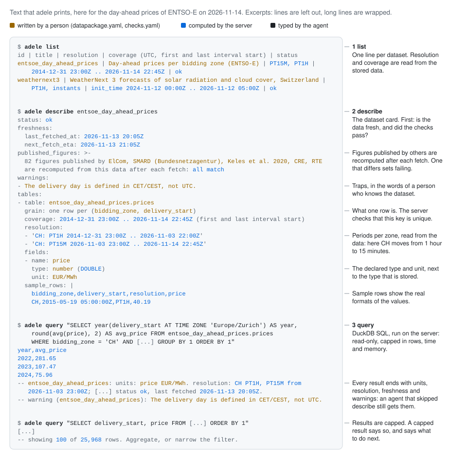

# adele in two pictures

A first read of what adele is about. The reference is [SPEC.md](../SPEC.md), and the reasons
are in [DECISIONS.md](../DECISIONS.md).

Status: drawn by Claude on 2026-11-14 from SPEC.md, DECISIONS.md (D1 to D24) and the server
code of that day. Both figures are SVG files written by hand. To change a text, edit the file.

## 1. From a source to an answer



For each dataset, adele has two inputs. The first is the rows that `fetch.py` gets from the
source. The second is what a person who knows the dataset declared about it, in
`datapackage.yaml` and `checks.yaml`. The server compares the two in the stage `check`. An agent
then gets the declaration and the data together, with a status that says whether the last fetch
and the last checks passed.

Not built on 2026-11-14: `adele pull`, and the email to the admin (a change of status is written
to `alerts.log`).

## 2. What an agent reads



The text is what the server printed on 2026-11-14, shortened: lines are left out and long lines
are wrapped. The colours show where each value comes from. A person wrote the amber values in
the dataset folder. The server computed the blue values: from the stored data (resolution,
coverage, sample rows, the stored type), from the fetches (freshness) and from the checks
(status, "all match").

## Keeping the figures true

Open on 2026-11-14: the README does not show figure 1. The line to add, e.g. under "What adele
does": ``.

Update figure 1 when:

- `adele pull` is built: remove the dashed circle and "(not built yet)" from step 4.
- the status `stale` is built: the status row shows only `ok` and `failing`.
- the email to the admin is built: remove the "Not built" line above.

Update figure 2 when:

- D20 is built (the footer shows only the warnings marked for it), or `render.py` prints the
  list, the card or the footer differently. `render.py` changed in the working tree after the
  text was captured (2026-11-14, about 17:15).
- the first warning of `entsoe_day_ahead_prices` (the one on 2025-10-01) is rewritten. The
  figure leaves it out on purpose, because TODOs.md says that Renaud will rewrite it.

How the text of figure 2 was captured, without the HTTP server (run in `server/` with
`uv run python`; check that the functions still have these names):

```python
from adele_server import config as config_mod, engine, render
from adele_server.catalog import load_catalog

cfg = config_mod.load("adele-server.toml")
catalog = load_catalog(cfg.datasets_dirs)
print(render.render_list(cfg, catalog))
print(render.render_describe(cfg, catalog["entsoe_day_ahead_prices"]))
res = engine.run(catalog, cfg.data_dir, cfg.query, sql)
print(render.render_query(res, render.query_footer(cfg, catalog, res.datasets)))
```

The two queries of the figure: the mean price of CH per local year for 2022 to 2024
(`year(delivery_start AT TIME ZONE 'Europe/Zurich')`, `round(avg(price), 2)`), and
`SELECT delivery_start, price` for CH from 2024-01-01 (capped at 100 of 25,968 rows).

Editing the SVG files:

- A CSS rule of the `<style>` block wins over an attribute such as `font-size="22"` or
  `stroke-width="2"` on the element. Sizes and stroke widths are therefore classes.
- The dark colours are the rules inside `@media (prefers-color-scheme: dark)`. Every colour of
  the light variant needs its dark rule.
- Figure 2: a line of the session holds up to 88 characters. Line n has its baseline at
  y = 132 + 17 n, and a note sits on the line that it explains.

Checking a render (both were checked this way on 2026-11-14, not in VS Code's preview and not on
a git host):

- `rsvg-convert -z 2 docs/overview.svg -o out.png`, then look at the PNG.
- Dark: render a copy in which the rules of the `@media` block stand outside the block.
- WebKit, with the system fonts: `qlmanage -t -s 1920 -o <dir> <file.svg>`. It crops a wide
  figure to a square, so give the copy a square `viewBox`.
